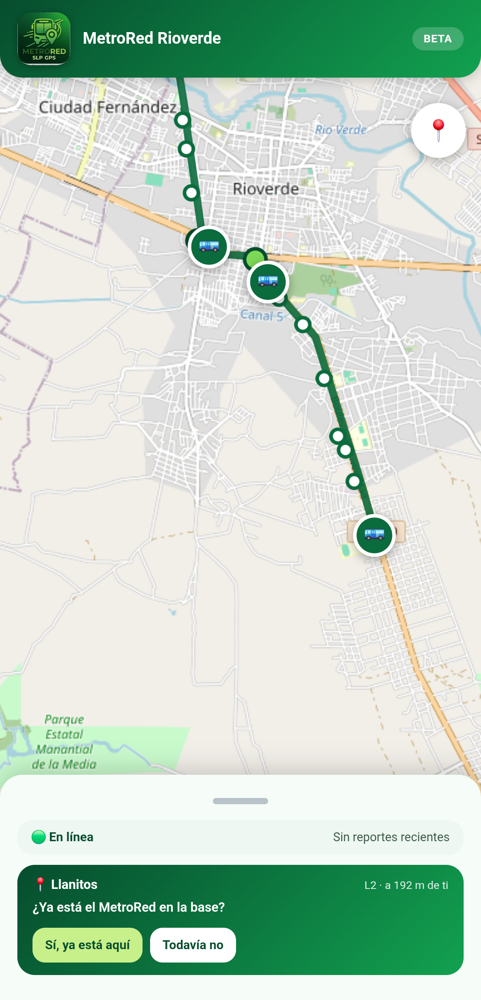

# 🚌 Metro Red Rioverde — ¡Tu próximo autobús, a un toque!

**Prototipo independiente para Android y web pensado para moverse más fácil entre Rioverde y Ciudad Fernández (Zona Media, SLP).**

 

<!-- Botón Grande de Descarga Directa -->

  

*Mira dónde viene tu camión, revisa las paradas y calcula cuánto falta para que llegue sin quedarte esperando bajo el sol.*

---

## 📥 Cómo descargar e instalar en Android

1. **Ve a la página de descarga:** Toca el botón rojo de **DESCARGAR APK** arriba para entrar a [nyvors.github.io/Metrored](https://nyvors.github.io/Metrored/) (o entra a la sección de **Releases** de este repositorio).
2. **Descarga el archivo:** Pulsa el botón de descarga directa en la página para obtener la última versión del `.apk`.
3. **Instala la aplicación:** Abre el archivo descargado. Si es la primera vez que instalas una app fuera de Play Store, Android te pedirá activar la opción **Permitir desde esta fuente**.
4. **Configura tu ubicación:** Abre **MetroRed Rioverde** y acepta el permiso de ubicación (solo se pide una vez) para detectar las paradas cercanas y activar los reportes.

---

## 🌟 ¿Por qué usar Metro Red?

Ya sea que vayas a clases, al trabajo, de compras o a visitar a alguien entre **Rioverde** y **Ciudad Fernández**, esperar sin saber cuándo pasa la unidad hace perder tiempo. Este prototipo reúne en una pantalla clara:

* 🗺️ **Mapa interactivo + lista de paradas:** Ubica el recorrido y revisa los puntos clave del mapa público de la SCT.
* ⏱️ **Tiempos estimados de llegada (ETA):** Mira en cuánto tiempo llega el siguiente autobús a tu parada.
* 🚍 **Dos rutas principales cubiertas:** **L1 Rioverde–Ciudad Fernández** y **L2 Eje Norte–Sur**.
* 📡 **Listo para crecer a GPS real:** Hoy funciona con una simulación fluida (4 unidades por línea, ~50 min de ida y ~17 min de espera en base) y está preparado para conectarse a un servidor de ubicación real.

---

## 📸 Vista previa de la app

  
  &nbsp;&nbsp;&nbsp;&nbsp;

---

## 🗺️ Rutas incluidas en el prototipo

| Línea | Recorrido | Unidades simuladas | Tiempo de ida aprox. | Espera en base aprox. |
| :--- | :--- | :---: | :---: | :---: |
| **L1** | **Rioverde – Ciudad Fernández** | 4 autobuses | ~50 min | ~17 min |
| **L2** | **Eje Norte – Sur** | 4 autobuses | ~50 min | ~17 min |

> ⚠️ **Nota importante:** Este es un proyecto independiente y **no utiliza logos ni marcas oficiales**. Las ubicaciones de las paradas en el prototipo son aproximaciones tomadas del mapa público de la SCT y están pensadas para validarse con coordenadas exactas.
